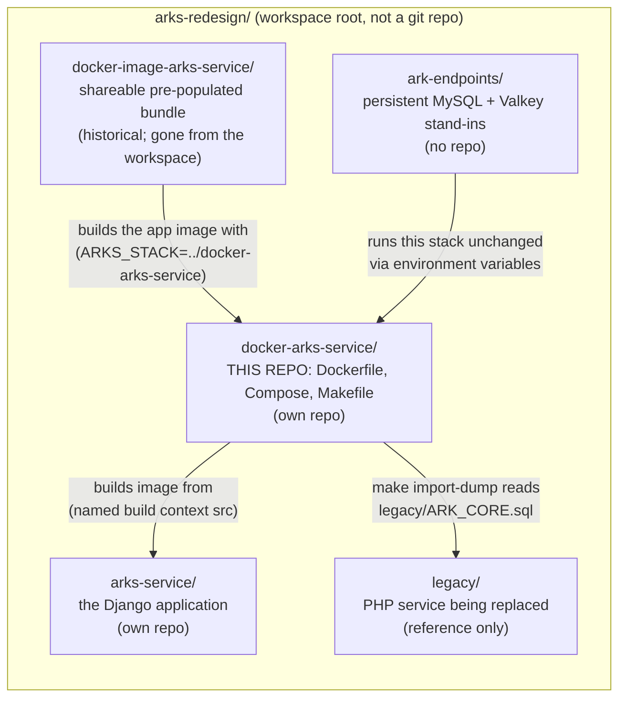
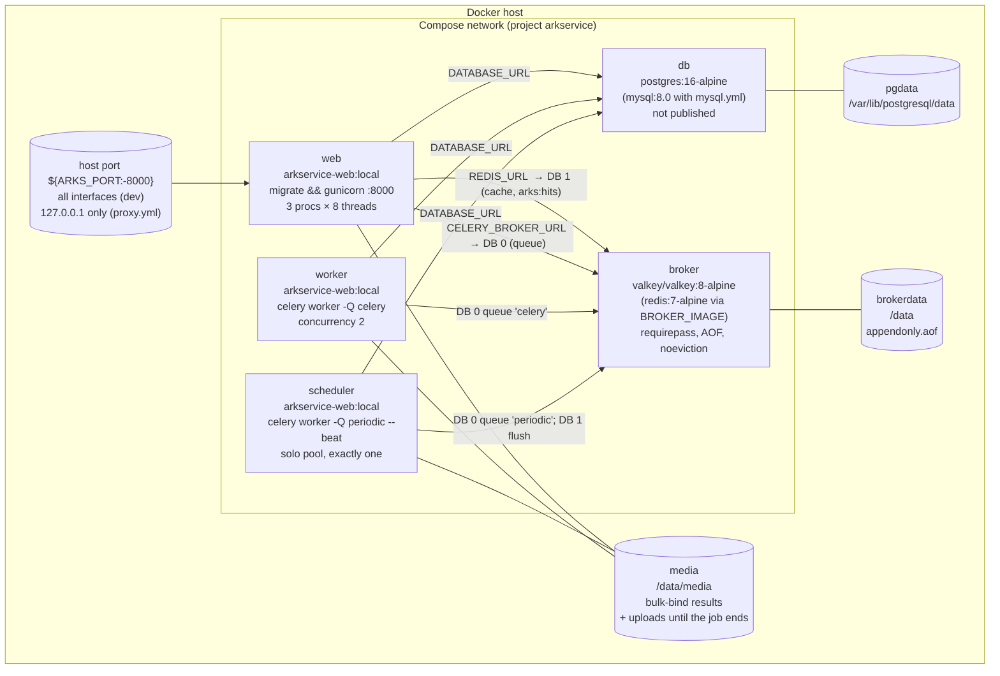
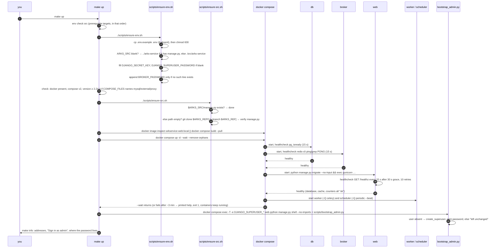
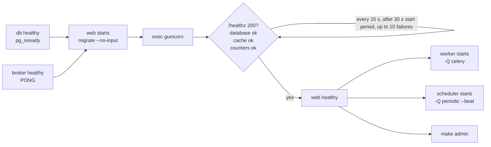
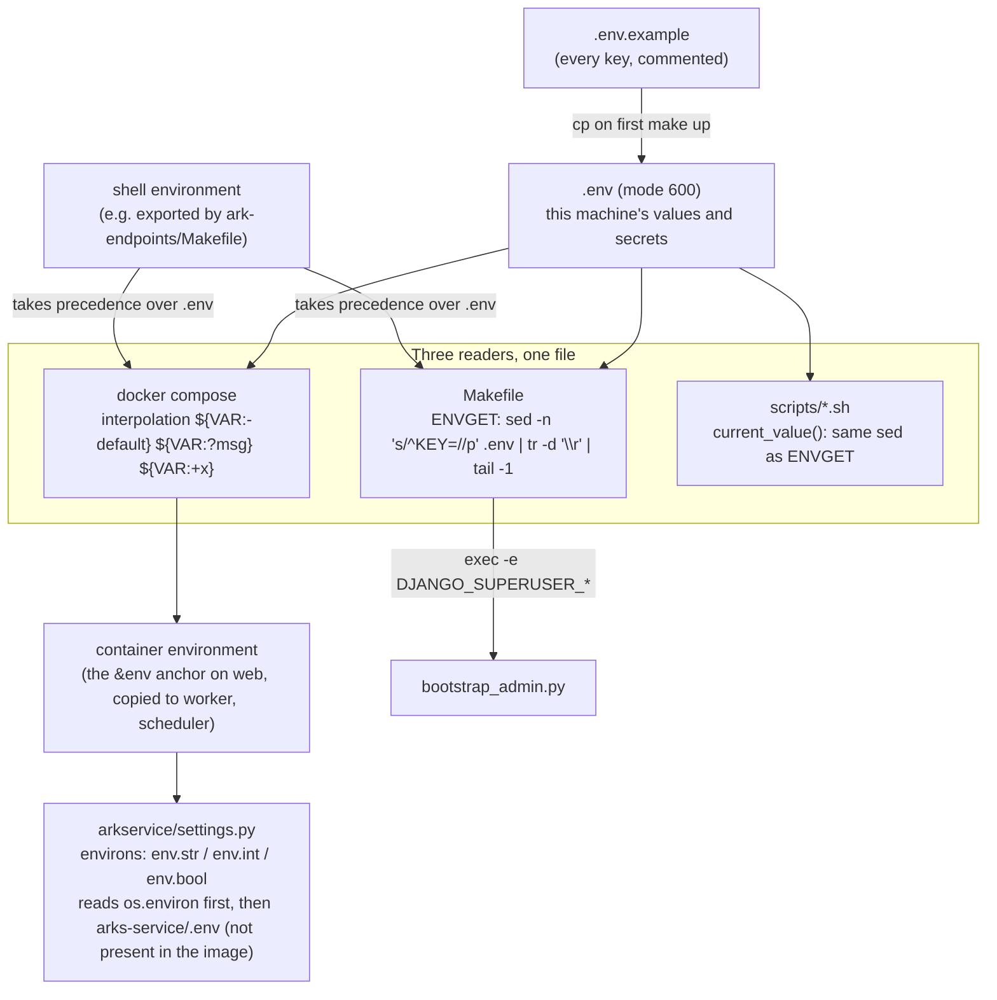
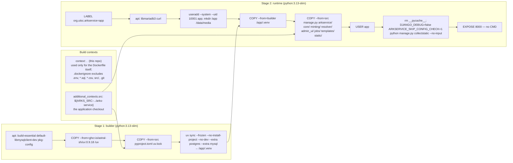
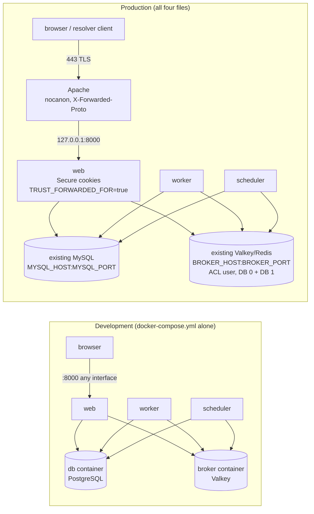
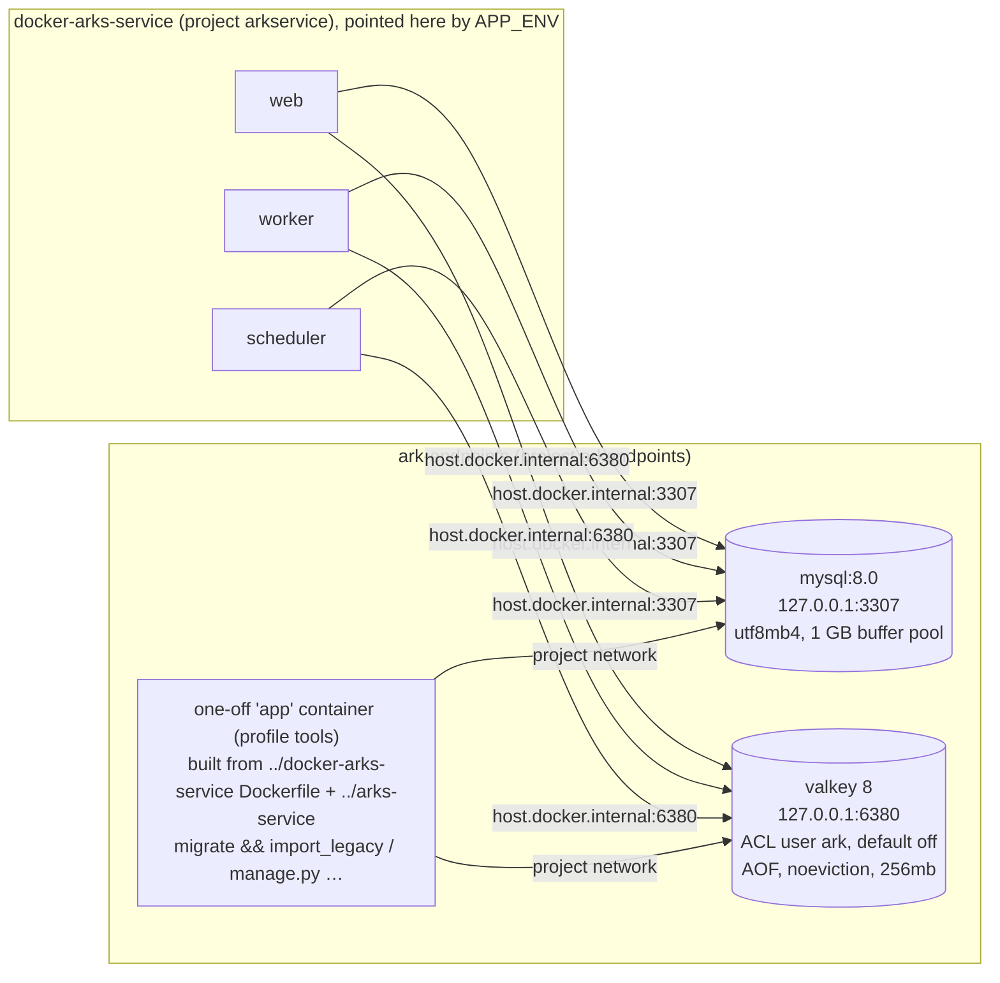
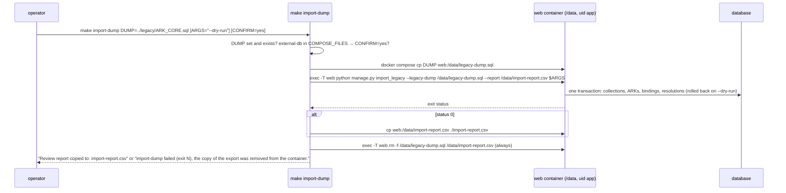

# docker-arks-service — study guide

A complete walk through the Docker stack for the UTSC ARK identifier service: every file, every `make` target, every Compose override and how they merge, how configuration flows from `.env` into the containers, how the image is built, how the stack is pointed at servers you already have, and how it is run day to day.

Written 2026-11-05 from the repository as it stands (`ea39a35 Document the production stack`). Everything quoted below (flags, messages, defaults) is taken from the files; where the README says something different, the discrepancy is called out.

Companion documents: `README.md` (operator reference), `docs/MIGRATION.md` (rehearsing the legacy import here), and in the application repository `DEPLOY.md`, `MIGRATION.md`, `USAGES.md`. The application itself is described in `../arks-service/docs/GUIDES.md`.

---

## Contents

1. [What this repository is](#1-what-this-repository-is)
2. [Repository map](#2-repository-map)
3. [The stack at a glance](#3-the-stack-at-a-glance)
4. [Start-up sequence](#4-start-up-sequence)
5. [The Makefile, target by target](#5-the-makefile-target-by-target)
6. [Configuration flow](#6-configuration-flow)
7. [The image](#7-the-image)
8. [Overrides and how they merge](#8-overrides-and-how-they-merge)
9. [Porting to existing servers](#9-porting-to-existing-servers)
10. [Behind Apache](#10-behind-apache)
11. [Processes inside the containers](#11-processes-inside-the-containers)
12. [Data and persistence](#12-data-and-persistence)
13. [Rehearsing the migration](#13-rehearsing-the-migration)
14. [Operating it](#14-operating-it)
15. [Troubleshooting](#15-troubleshooting)
16. [Security notes](#16-security-notes)
17. [Design decisions and why](#17-design-decisions-and-why)
18. [Glossary](#18-glossary)

---

## 1. What this repository is

`docker-arks-service` is the **deployment** half of a deliberate split:

| Repository | Holds | Does not hold |
|---|---|---|
| `arks-service` (the application) | Django code, tests, bare-VM `deploy/` files (systemd units, Apache vhost) | any Docker file, not even a `.dockerignore` |
| `docker-arks-service` (this one) | Dockerfile, Compose files, Makefile, bootstrap scripts | any application code |

The stack builds an image **from a checkout of the application**, which it finds beside itself or clones for you. The application never needs to know it runs in a container; the container never carries the developer's working tree.

### Three audiences, one stack

| Audience | How they use it | Database | Broker |
|---|---|---|---|
| **Developers** | `make up` beside their `arks-service` checkout; `make install` after each code change | PostgreSQL 16 container (or MySQL 8.0 container to match production) | Valkey container (or Redis) |
| **Demos / prototyping** | A clone of this repository alone; `make up` fetches the application | same containers | same |
| **Production** | The same files with two or three overrides: an existing MySQL server, an existing Valkey/Redis server, Apache with TLS in front | **no** database container | **no** broker container |

The point of the overrides is that production is not a different stack. It is the development stack with its own servers parked and the application pointed at someone else's.

### Neighbours in the workspace



- **`arks-service`** — the code. Renamed on GitHub from `arks-service-new` on 2026-10-30; the stack's default clone URL is `https://github.com/digitalutsc/arks-service.git`.
- **`arks-cli`** — the optional staff command line (`createcollection`, `mint`, `bind`, `unbind`, `bulk_bind`, `ark_stats`), a separate plugin since 2026-11-07. The image includes it only when `ARKS_PLUGIN_SRC` points at a checkout; otherwise the `plugin` build context is `plugins-none/` and nothing is installed. It is enabled at run time with `ARKS_PLUGINS=arks_cli`, which the shared `environment` anchor passes to `web`, `worker` and `scheduler`.
- **`docker-image-arks-service`** — *historical.* A former sibling repository that built a shareable bundle from this stack's app image plus a PostgreSQL image already holding the imported legacy data (port 8001, project name `arkservice-image`, its own `make snapshot` / `make bundle` / `make load` / `make reset`; none of those targets exist here). It has been removed from the workspace and is not on GitHub; the only trace left in this stack is that the image label and `make prune` were designed not to touch a snapshot's tagged image. Nothing below depends on it. (The workspace's `CLAUDE.md`, which described it, is a file of the surrounding `arks-redesign` workspace, not of this repository.)
- **`ark-endpoints`** — a persistent MySQL and Valkey standing in for production's external servers, plus a Makefile that drives *this* stack against them without editing any file here. Section 9 explains how.

---

## 2. Repository map

```
docker-arks-service/
├── Makefile                              every operation; `make` alone lists targets
├── Dockerfile                            two-stage image; copies the app from the named context `src`
├── docker-compose.yml                    the development default: db (PostgreSQL), broker (Valkey), web, worker, scheduler
├── docker-compose.mysql.yml              override: MySQL 8.0 container instead of PostgreSQL
├── docker-compose.external-db.yml        override (production): an existing MySQL server, no db container
├── docker-compose.external-broker.yml    override (production): an existing Valkey/Redis server, no broker container
├── docker-compose.proxy.yml              override: behind Apache/TLS on the same host (loopback port, Secure cookies)
├── docker-compose.remote-proxy.yml       override: behind a TLS proxy on another machine (ARKS_BIND_ADDRESS port, Secure cookies)
├── .env.example                          every setting with its comment; `make up` copies it to .env
├── .env                                  THIS MACHINE's settings and secrets (gitignored, mode 600)
├── .dockerignore                         keeps .env, exports, CSVs and src/ out of the main build context
├── .gitignore                            .env, /src/, *.sql, *.sql.gz, import-report.csv, cutover-diff.csv
├── scripts/
│   ├── ensure-env.sh                     create .env, fill ARKS_SRC and blank secrets; never overwrite a set value
│   ├── ensure-src.sh                     clone the application into ARKS_SRC if nothing is there; never touch a checkout
│   └── bootstrap_admin.py                piped into `manage.py shell`: create the admin once, never alter it
├── plugins-none/README.md               the default `plugin` build context: no pyproject.toml, so no plugin is installed
├── README.md                             operator documentation
├── docs/                                 every document but README.md
│   ├── MIGRATION.md                      rehearsing the legacy import in this stack
│   └── GUIDES.md                         this guide
├── import-report.csv                     left by the last `make import-dump` (gitignored; header: reason,table,ark_path,element,value)
└── src/                                  (only when no sibling checkout) the cloned application, gitignored
```

The `.ipynb_checkpoints/` directory is a Jupyter artefact holding stale copies that still say `arks-service-new`; ignore it when grepping.

---

## 3. The stack at a glance

Compose project name: **`arkservice`** (fixed in `docker-compose.yml`: `name: arkservice`). Containers are therefore `arkservice-web-1`, `arkservice-worker-1`, `arkservice-scheduler-1`, `arkservice-db-1`, `arkservice-broker-1`; volumes `arkservice_pgdata`, `arkservice_media`, `arkservice_brokerdata` (and `arkservice_mysqldata` under the MySQL override).



The one server in `broker` holds **two logical databases**: `0` is the Celery queue (bulk-bind jobs on queue `celery`, housekeeping on queue `periodic`), `1` is the Django cache (login throttle, element-name lists, collection statistics, the "last minted" ids) plus the buffered redirect-hit hash `arks:hits`. The resolver itself does not read the cache; a redirect is two MySQL/PostgreSQL reads and one `HINCRBY`.

### Service by service

| | `db` | `broker` |
|---|---|---|
| Image | `postgres:16-alpine` (`mysql:8.0` with the MySQL override) | `${BROKER_IMAGE:-valkey/valkey:8-alpine}` |
| Command | image default | `--requirepass "${BROKER_PASSWORD:-}" --appendonly yes --appendfsync everysec --maxmemory-policy noeviction --maxmemory ${BROKER_MAXMEMORY:-200mb}` |
| Environment | `POSTGRES_DB/USER/PASSWORD` (default `ark`), applied only when the volume is first created | `BROKER_PASSWORD` (for the healthcheck) |
| Volumes | `pgdata:/var/lib/postgresql/data` | `brokerdata:/data` |
| Healthcheck | `pg_isready -U $POSTGRES_USER -d $POSTGRES_DB`, every 15 s, 10 retries | `redis-cli ping \| grep -q PONG` with `REDISCLI_AUTH` exported when a password is set; every 15 s, 10 retries |
| restart | `unless-stopped` | `unless-stopped` |
| mem_limit | none | `${BROKER_MEM_LIMIT:-256m}` |
| Ports | none (commented out: `# ports: ["5432:5432"]`) | none |
| Logging | json-file 10m × 5 | json-file 10m × 5 |

| | `web` | `worker` | `scheduler` |
|---|---|---|---|
| Image | `arkservice-web:local`, **built here** (`build.context: .`, `additional_contexts.src: ${ARKS_SRC:-../arks-service}`, `additional_contexts.plugin: ${ARKS_PLUGIN_SRC:-./plugins-none}`) | `arkservice-web:local` (no build section; reuses web's) | `arkservice-web:local` |
| Command | `sh -c "python manage.py migrate --no-input && exec gunicorn arkservice.wsgi:application --bind 0.0.0.0:8000 --workers 3 --threads 8 --worker-class gthread --timeout 60 --graceful-timeout 30 --keep-alive 5 --max-requests 2000 --max-requests-jitter 200 --access-logfile -"` | `celery -A arkservice worker -Q celery --concurrency 2 --max-tasks-per-child 20 --max-memory-per-child 1000000 --loglevel=info` | `celery -A arkservice worker -Q periodic --pool solo --concurrency 1 --beat --loglevel=info` |
| depends_on | `db: service_healthy`, `broker: service_healthy` | db, broker, **web** healthy | db, broker, **web** healthy |
| Healthcheck | `curl -fsS http://localhost:8000/healthz`, 15 s interval, 5 s timeout, 10 retries, 30 s start period | none | none |
| restart | `unless-stopped` | `unless-stopped` | `unless-stopped` |
| mem_limit | `${WEB_MEM_LIMIT:-1g}` | `${WORKER_MEM_LIMIT:-2g}` | `${SCHEDULER_MEM_LIMIT:-256m}` |
| stop_grace_period | 35 s (above gunicorn's 30 s graceful timeout) | 120 s (let a running bulk bind finish) | 30 s |
| Volumes | `media:/data/media` | `media:/data/media` | `media:/data/media` |
| Ports | `${ARKS_PORT:-8000}:8000` | none | none |
| Environment | the shared anchor `&env` (section 6) | `*env` | `*env` |

The three application services share one environment block through a YAML anchor, so they can never disagree on a cap or a URL.

---

## 4. Start-up sequence

`make up` is "the only target you need" and is safe to repeat. From an empty clone:



### Dependency and health ordering



Why worker and scheduler wait for **web** and not just for the database: web runs the migrations. A worker that started on a half-built schema during a first install would crash and restart until the schema settled; waiting on web's health makes the first install deterministic.

Timing budget: `start_period: 30s` + 10 × 15 s ≈ three minutes before `up --wait` gives up. A first MySQL-container start (volume initialisation) plus a full migration set fits inside it; an external server that is unreachable does not, which is what the failure message describes:

> The stack did not become healthy in time. A first start can take several minutes … Against an external database, web waits until it can reach that server. Nothing has been undone; the containers keep going.

---

## 5. The Makefile, target by target

```makefile
SHELL := /bin/sh
.DEFAULT_GOAL := help
.NOTPARALLEL:
COMPOSE ?= docker compose
IMAGE := arkservice-web:local
LABEL := org.utsc.arkservice=app
REPORT ?= import-report.csv
CONFIRM ?=
```

### Three mechanisms you must understand first

**`ENVGET` reads `.env` at recipe time, not parse time.**

```makefile
ENVGET = $$(sed -n 's/^$(1)=//p' .env 2>/dev/null | tr -d '\r' | tail -1)
```

`make up` *creates* `.env` during its own run (`env` target), long after Make has parsed the Makefile. A parse-time `$(shell …)` would read a file that does not exist yet. So `ENVGET` expands to a shell `$(…)` substitution that the recipe's shell evaluates when the line runs. `tr -d '\r'` makes a CRLF-saved `.env` harmless; `tail -1` takes the last definition if a key is repeated.

**`COMPOSE_FILES` honours the shell before `.env`, exactly as Compose does.**

```makefile
COMPOSE_FILES = $${COMPOSE_FILE:-$(call ENVGET,COMPOSE_FILE)}
```

If `COMPOSE_FILE` is exported in the calling shell it wins; otherwise the value from `.env`. This is what lets `ark-endpoints/` drive the stack against external servers without editing `.env` (section 9), and it is why the Makefile's own guards (`check`, `confirm-external`, `import-dump`) see the same file list Compose will use.

**`TEARDOWN_ENV` supplies throwaway values so `down` never fails on a blank `.env`.**

```makefile
TEARDOWN_ENV := DJANGO_SECRET_KEY=unused-while-tearing-the-stack-down \
                MYSQL_HOST=unused-while-tearing-the-stack-down \
                MYSQL_PASSWORD=unused-while-tearing-the-stack-down \
                BROKER_HOST=unused-while-tearing-the-stack-down
```

Compose interpolates every `${VAR:?message}` for *every* command, `down` included. `DJANGO_SECRET_KEY` is mandatory always; `MYSQL_HOST`/`MYSQL_PASSWORD` under the external-db file; `BROKER_HOST` under the external-broker file. Without these, a machine whose `.env` was deleted could not even stop its own containers. The values reach no container because `down` starts nothing.

`.NOTPARALLEL` forbids `make -j`: the targets share `.env` and the Docker daemon state, and `up` depends on `env` having finished writing.

### Lifecycle targets

| Target | Prerequisites | Runs | Side effects and rules |
|---|---|---|---|
| `help` (default) | — | `sed`/`awk` over `## ` comments | Lists every target with its one-line description |
| `up` | `env check src` | `docker image inspect $(IMAGE) \|\| $(COMPOSE) build --pull`; `$(COMPOSE) up -d --wait --remove-orphans`; then `admin`, `info` | Idempotent: never regenerates a set value, never pulls an existing checkout, never rebuilds an existing image, never alters an existing admin. On health timeout prints the help block and exits 1 with containers running |
| `install` | `build up` | after `up`: `docker image prune -f --filter label=$(LABEL)` | "Same as up but always rebuild first." Required after **any** code change (source is baked in). Prunes again after `up` because the image the old containers were running only dangles once they are replaced |
| `build` | `env check src` | `$(COMPOSE) build --pull`; prune dangling labelled images | `--pull` refreshes `python:3.13-slim` and the pinned uv image |
| `down` | — | `$(TEARDOWN_ENV) $(COMPOSE) down --remove-orphans` | Stops and removes containers; **keeps every volume**; works with a blank or missing `.env` |
| `clean` | `confirm-external` | `$(TEARDOWN_ENV) $(COMPOSE) down --volumes --remove-orphans`; `docker image rm -f $(IMAGE)` | Removes containers, the volumes of whichever services the current `COMPOSE_FILE` declares, and the image. **Keeps `.env`** ("it holds this machine's secret key and admin password"). Never touches an external database or broker |
| `rebuild` | `confirm-external clean install` | — | Blow away and start from scratch |
| `prune` | — | `docker image prune -f --filter label=$(LABEL)`; `docker builder prune -f --filter until=24h`; list other `arkservice-*` tags | Build-cache prune is **not** label-scoped (cache carries no labels), so it is Docker-wide for cache older than a day. Other tags are listed, never removed |

### Guard targets

| Target | What it checks | Message |
|---|---|---|
| `check` | `docker` on PATH; `docker compose version` works; if `COMPOSE_FILES` matches `*mysql*\|*external*\|*proxy*`, Compose version ≥ 2.24.4 via an `awk` comparison on `version --short` | "docker-compose.mysql.yml, docker-compose.proxy.yml and the external-db/external-broker files need Docker Compose 2.24.4 or later (found $v)." |
| `confirm-external` | If `COMPOSE_FILES` contains `external`: `CONFIRM=yes` → pass; otherwise prompt `Type yes to go ahead:` and abort with "Nothing done." on anything else | "COMPOSE_FILE uses an external database or broker: this looks like production. This stops the service and removes the stack's containers, volumes and image. The external servers themselves are not touched." |

The reasoning in the Makefile comment: `clean` never touches the external server, but a machine configured that way *is* production, where taking the stack apart is an outage and drops the broker container's queued jobs. A development stack names no external file and is never asked.

### Bootstrap targets

| Target | Runs | Notes |
|---|---|---|
| `env` | `./scripts/ensure-env.sh` | Creates `.env` if absent; fills `ARKS_SRC`, `DJANGO_SECRET_KEY`, `DJANGO_SUPERUSER_PASSWORD` when blank; adds `BROKER_PASSWORD` only when the line is absent |
| `src` | `env`, then `./scripts/ensure-src.sh` | Clones the application into `ARKS_SRC` if nothing is there |
| `admin` | `$(COMPOSE) exec -T -e DJANGO_SUPERUSER_USERNAME=… -e …EMAIL=… -e …PASSWORD=… web python manage.py shell --no-imports < scripts/bootstrap_admin.py` | Credentials are passed on that one `exec`, never put in the service definition or the image |
| `info` | prints `Public resolver http://localhost:$port/`, `Staff interface http://localhost:$port/admin/`, `Sign in as $user` and where the password is | `$port` defaults to 8000 if `ARKS_PORT` is blank |

### Everyday targets

| Target | Runs |
|---|---|
| `logs` | `$(COMPOSE) logs -f` |
| `ps` | `$(COMPOSE) ps` |
| `shell` | `$(COMPOSE) exec web sh` — `/bin/sh` at `/app` as uid 10001 |
| `manage` | `$(COMPOSE) exec web python manage.py $(ARGS)`; `ARGS` empty → `$(error Usage: make manage ARGS="<command> [options]")` |

### `import-dump`

```makefile
import-dump: ## Import a legacy export: make import-dump DUMP=/path/ark.sql [ARGS="--dry-run"]
```

1. `DUMP` empty → `$(error Usage …)`; file missing → "No such file: $(DUMP)".
2. If `COMPOSE_FILES` contains `external-db` and `CONFIRM` is not `yes` → refuse: "COMPOSE_FILE uses docker-compose.external-db.yml, so this would import into the external MySQL server, not a container. Run it again with CONFIRM=yes if that is what you mean, after a rehearsal with ARGS=\"--dry-run\"." (The dry run needs `CONFIRM=yes` too.)
3. `docker compose cp "$(DUMP)" web:/data/legacy-dump<suffix>` then `exec -T web python manage.py import_legacy --legacy-dump /data/legacy-dump<suffix> --report /data/import-report.csv $(ARGS)`.
4. On success, `cp web:/data/import-report.csv "$(REPORT)"`.
5. **Always** `exec -T web rm -f /data/legacy-dump<suffix> /data/import-report.csv` — one shell line from copy to removal, so the export (with its staff passwords) leaves the container whether the import succeeded or failed.
6. Exit with the importer's status.

Why `/data` and not `/tmp`: `docker compose cp` writes as root while the container runs unprivileged, and `/tmp` is sticky, so the application user could not delete its own import afterwards. `/data` belongs to `app`.

### The image label

The Dockerfile sets `LABEL org.utsc.arkservice=app`. `build`, `install` and `prune` all run `docker image prune -f --filter label=org.utsc.arkservice=app`, which removes **only dangling** (untagged) images carrying this label. A tagged image such as a snapshot's `arkservice-web:<tag>`, and every other project's images, survive. Images built before the label existed carry none and must be removed once by hand (`docker image ls --filter dangling=true`).

---

## 6. Configuration flow



Two parsers read `.env`: Compose's dotenv and the Makefile's `sed`. They agree only if **comments stay on their own lines and values are never quoted**: a trailing `# note` or a pair of quotes becomes part of the value for one of them. The README's example: a quoted password creates an account whose password includes the quotes.

### Variables

**Stack-only** (consumed by the Makefile, the scripts, or Compose itself; never reach Django):

| Variable | Default | Role |
|---|---|---|
| `ARKS_SRC` | filled in by `ensure-env.sh` | Path to the application checkout; also the named build context `src` |
| `ARKS_REPO` | empty = this repo's origin with the last path component swapped | Clone URL when `ARKS_SRC` is empty |
| `ARKS_REF` | empty = default branch | `git clone --branch` |
| `ARKS_PORT` | `8000` | Host port for `web` |
| `ARKS_EXTRA_HOSTS` | empty | Appended to `DJANGO_ALLOWED_HOSTS` after `localhost,127.0.0.1` |
| `COMPOSE_FILE` | commented out | The override list (section 8) |
| `BROKER_IMAGE` | `valkey/valkey:8-alpine` | `redis:7-alpine` for Redis |
| `WEB_MEM_LIMIT` / `WORKER_MEM_LIMIT` / `SCHEDULER_MEM_LIMIT` / `BROKER_MEM_LIMIT` | `1g` / `2g` / `256m` / `256m` | Docker `mem_limit` per container |
| `BROKER_MAXMEMORY` | `200mb` | Valkey/Redis `--maxmemory`; keep below `BROKER_MEM_LIMIT` |
| `DJANGO_SUPERUSER_USERNAME` / `_EMAIL` / `_PASSWORD` | `admin` / `admin@example.org` / generated | Only used by `make admin` |

**Database**

| Variable | Default | Used by |
|---|---|---|
| `POSTGRES_DB` / `POSTGRES_USER` / `POSTGRES_PASSWORD` | `ark` / `ark` / `ark` | PostgreSQL container (applied when its volume is first created) and web's `DATABASE_URL=postgres://${POSTGRES_USER}:${POSTGRES_PASSWORD}@db:5432/${POSTGRES_DB}` |
| `MYSQL_DATABASE` / `MYSQL_USER` / `MYSQL_PASSWORD` | `ark` / `ark` / `ark` | MySQL container (first volume creation) **and** the external server's existing database and account |
| `MYSQL_ROOT_PASSWORD` | `${MYSQL_PASSWORD}` | MySQL container only |
| `MYSQL_HOST` | **none** (`${MYSQL_HOST:?set MYSQL_HOST in .env to the MySQL server}`) | external-db only |
| `MYSQL_PORT` | `3306` | external-db only |

**Broker**

| Variable | Default | Used by |
|---|---|---|
| `BROKER_PASSWORD` | generated when the line is **absent**; a present-but-blank line is respected (auth off) | broker container `--requirepass`; app URLs `redis://${BROKER_PASSWORD:+:$BROKER_PASSWORD@}broker:6379/…` (the `:+` form inserts `:pw@` only when non-empty); the healthcheck's `REDISCLI_AUTH` |
| `BROKER_HOST` | **none** (`:?set BROKER_HOST in .env to the Valkey or Redis server`) | external-broker only |
| `BROKER_PORT` | `6379` | external-broker |
| `BROKER_USERNAME` | empty = default user | external-broker; URL `redis://user:pw@host` |
| `BROKER_QUEUE_DB` / `BROKER_CACHE_DB` | `0` / `1` | external-broker; must differ (not enforced) |
| `BROKER_SCHEME` / `BROKER_URL_OPTIONS` | `redis` / empty | external-broker; TLS = `rediss` + `?ssl_cert_reqs=required` |

**Pass-through application settings** — each is spelled in `docker-compose.yml` with its default so the three processes always agree, and a blank default means "the application's own default":

| Variable | Default in Compose | Meaning |
|---|---|---|
| `DJANGO_DEBUG` | `"false"` | Leave false |
| `DJANGO_ALLOWED_HOSTS` | `"localhost,127.0.0.1${ARKS_EXTRA_HOSTS:+,$ARKS_EXTRA_HOSTS}"` | Healthcheck needs `localhost` |
| `SESSION_COOKIE_SECURE` / `CSRF_COOKIE_SECURE` | `"false"` (proxy.yml: `"true"`) | Plain HTTP on a workstation |
| `MEDIA_ROOT` | `/data/media` | The `media` volume |
| `DJANGO_CSRF_TRUSTED_ORIGINS` | `""` | Only when forms are posted from another hostname |
| `TRUST_FORWARDED_FOR` | `"false"` (proxy.yml: `"true"`) | Login-throttle client address from `X-Forwarded-For` |
| `SECURE_HSTS_SECONDS` | `"0"` | Raise once TLS is proven |
| `ARK_PUBLIC_BASE_URL` | `""` | Only when staff and resolver hostnames differ |
| `DB_CONN_MAX_AGE` | `"60"` | Seconds a DB connection is reused |
| `DB_CONNECT_TIMEOUT` / `DB_READ_TIMEOUT` / `DB_WRITE_TIMEOUT` | `"5"` / `"60"` / `"60"` | MySQL only |
| `CACHE_SOCKET_TIMEOUT` | `"0.5"` | Cache/broker socket timeout |
| `MINT_MAX_PER_REQUEST` | `"10000"` | 0 removes the cap |
| `FALLBACK_DIR` | empty | Host directory of operator-written `index.html`, `403.html`, `404.html`, `500.html` and assets, mounted read-only at `/data/fallback` in `web`; `FALLBACK_PAGES_DIR` is set inside the container only when this is set (`${FALLBACK_DIR:+/data/fallback}`). Blank mounts the stack's empty `fallback/` and the application ignores it. Kit: `docs/fallback-example/` in the application repository |
| `BULK_BIND_MAX_ROWS` / `BULK_BIND_MAX_BYTES` | `"100000"` / `"52428800"` | Upload ceilings |
| `BULK_BIND_RETENTION_DAYS` | `"0"` | 0 keeps jobs forever |
| `CELERY_TASK_TIME_LIMIT` | `"3600"` | Hard job limit |
| `MANIFEST_FETCH_TIMEOUT` / `MANIFEST_TOTAL_TIMEOUT` / `MANIFEST_MAX_CONCURRENT` | `"30"` / `"30"` / `"4"` | `/manifest` fetch budget per read, per fetch, and fetches at once per process |
| `COLLECTION_STATS_SECONDS` | `"300"` | Stored-count refresh |
| `SORT_SUBQUERY_MAX_ROWS` | `"50000"` | Redirects/Elements sort ceiling |
| `EXPORT_SYNC_MAX_ROWS` | `"100000"` | UI export ceiling |

Not passed through from `.env` but set by Compose: `DATABASE_URL`, `CELERY_BROKER_URL`, `REDIS_URL`, `DJANGO_SECRET_KEY` (`${DJANGO_SECRET_KEY:?run \`make up\` (or \`make env\`) to generate one in .env}` — mandatory, no default on purpose).

Numbers and booleans need a value: `DB_READ_TIMEOUT=` with nothing after it is passed as an empty string, which `environs` cannot parse, and the application stops at start-up. Comment such a line out instead of blanking it.

### How secrets are generated

`ensure-env.sh`:

```sh
random_secret() {
    if command -v openssl >/dev/null 2>&1; then
        openssl rand -base64 64 | tr -dc 'A-Za-z0-9' | cut -c1-48
    else
        python3 -c 'import secrets; print(secrets.token_urlsafe(64))' | tr -dc 'A-Za-z0-9' | cut -c1-48
    fi
}
```

Letters and digits only, 48 of them, because the value ends up in a URL, a shell, a Makefile and Compose interpolation, each with its own special characters. `generate_secret` refuses to write a value under 32 characters (Django's boot guard would treat it as unset, and the script would never regenerate it because it is no longer blank). `fill_if_blank` touches a key only when its current value is empty after stripping a trailing `\r`. `BROKER_PASSWORD` is different: it is generated only when `.env` has **no such line at all**, because a line that exists but is blank means "this server has no authentication" and must be respected.

### The password rule: container versus external server

User names and passwords are substituted into URLs (`DATABASE_URL`, `CELERY_BROKER_URL`, `REDIS_URL`), but for the stack's own containers they are *also* handed to the server raw: `docker-compose.yml` passes `BROKER_PASSWORD` unencoded to `--requirepass` and encoded into the client URLs (which redis-py decodes), `POSTGRES_PASSWORD` raw to the `db` container and into `DATABASE_URL`, and `docker-compose.mysql.yml` does the same with `MYSQL_PASSWORD`. A value that is percent-encoded for the URL therefore does not match what the server was given, and a raw special character breaks the URL. So:

- **Container passwords (PostgreSQL, MySQL container, broker): letters and digits only.** Generated secrets already are.
- **External servers (`docker-compose.external-db.yml`, `docker-compose.external-broker.yml`): percent-encode.** There the value only ever enters a URL, so a password you were given is written as `@` → `%40`, `/` → `%2F`, `#` → `%23`, `%` → `%25`, `:` → `%3A`.
- **Either way, `$` is Compose interpolation** inside a `.env` value: a literal `$` is written `$$`.

---

## 7. The image



Points worth knowing:

- **Named build context.** `docker-compose.yml` declares `build: {context: ., additional_contexts: {src: ${ARKS_SRC:-../arks-service}}}`. The Dockerfile copies only from `src`, one explicit line per top-level package. BuildKit sends the builder only the paths those lines name, so the developer's `.venv`, `.git`, `db.sqlite3`, `media/`, `staticfiles/` and `tests/` never enter the image, and the application repository needs no `.dockerignore`.
- **Consequence:** adding a new top-level Django app to `arks-service` means adding a `COPY --from=src --chown=app:app <app>/ <app>/` line here. A missing one is a `ModuleNotFoundError` at container start.
- **`uv sync --frozen`** installs exactly what `uv.lock` says and fails if the lock is out of date with `pyproject.toml`, instead of resolving something else. Both database extras are installed because the same image runs PostgreSQL in dev and MySQL in production.
- **Pinned uv** (`0.9.18`): `:latest` would change the build from under us.
- **collectstatic at build time** with `DJANGO_DEBUG=false` so the hashed `CompressedManifestStaticFilesStorage` is used, and `ARKSERVICE_SKIP_CONFIG_CHECK=1` because the boot guard would otherwise demand a secret key and a database that do not exist at build time. WhiteNoise then serves `/static/` from inside the image.
- **Unprivileged:** uid 10001 `app`, home `/app`, shell `nologin`. `/app` is writable by `app` so tools that write beside `manage.py` still can; Celery beat's schedule file goes to `/tmp`.
- **`tests/` is absent**, so the suite cannot run inside the container; run it from a checkout.
- **No `CMD`:** every service's command is in `docker-compose.yml`, one place to change.
- Size: about 330 MB (commit `a00edb2`: "855 MB to 332 MB"). `libmariadb3` is the runtime client library `mysqlclient` links against; psycopg's binary wheel carries its own libpq; `curl` is for the healthcheck.

---

## 8. Overrides and how they merge

Compose merges the files named in `COMPOSE_FILE` (colon-separated) left to right. Maps (`environment`, `depends_on`) merge key by key; lists (`ports`, `volumes`, `command`) are appended unless a tag says otherwise. Three YAML mechanics carry every override here:

| Mechanic | Effect | Needs |
|---|---|---|
| `!override` on a value | Replace the base value entirely instead of merging/appending | Compose ≥ 2.24.4 |
| `!reset` on a map key | Delete that key from the merged result | Compose ≥ 2.24.4 |
| `profiles: ["<unused>"]` on a service | An override cannot *delete* a service; parking it in a profile nothing activates means it is never created or started | any |

One subtlety governs all four files: the base file shares the application environment through a YAML anchor (`environment: &env` on web, `*env` on worker and scheduler). **Anchors are expanded before files are merged**, so each service holds its own copy of the environment, and an override that changes `DATABASE_URL` must do so **on web, worker and scheduler separately**. That is why every override repeats its block three times.

`make check` enforces the version floor: when `COMPOSE_FILES` matches `*mysql*|*external*|*proxy*`, it compares `docker compose version --short` against 2.24.4. Older Compose rejects the tags with a parse error that does not say why.

### `docker-compose.mysql.yml`

```yaml
services:
  db:
    image: mysql:8.0
    environment: !override
      MYSQL_DATABASE: ${MYSQL_DATABASE:-ark}
      MYSQL_USER: ${MYSQL_USER:-ark}
      MYSQL_PASSWORD: ${MYSQL_PASSWORD:-ark}
      MYSQL_ROOT_PASSWORD: ${MYSQL_ROOT_PASSWORD:-${MYSQL_PASSWORD:-ark}}
    volumes: !override [mysqldata:/var/lib/mysql]
    healthcheck:
      test: ["CMD-SHELL", "mysqladmin ping -h 127.0.0.1 -u \"$$MYSQL_USER\" -p\"$$MYSQL_PASSWORD\" --silent"]
      start_period: 30s
  web:       {environment: {DATABASE_URL: mysql://…@db:3306/…}}
  worker:    {environment: {DATABASE_URL: …}}
  scheduler: {environment: {DATABASE_URL: …}}
volumes:
  mysqldata:
```

- `!override` on `environment` keeps the `POSTGRES_*` keys from leaking into the MySQL container; on `volumes` it prevents the `pgdata` mount being appended beside `mysqldata`.
- The healthcheck pings over **TCP** (`-h 127.0.0.1`), not the socket: while the image initialises a new volume it runs a temporary server with networking off, so the database is not reported healthy until the real server listens.
- Each engine has its own volume, so switching back and forth destroys nothing. `make clean` removes the volumes of whichever engines the current `.env` declares.

### `docker-compose.external-db.yml`

```yaml
services:
  db:
    profiles: ["local-db-disabled"]
  web:
    environment:
      DATABASE_URL: mysql://${MYSQL_USER:-ark}:${MYSQL_PASSWORD:?set MYSQL_PASSWORD in .env}@${MYSQL_HOST:?set MYSQL_HOST in .env to the MySQL server}:${MYSQL_PORT:-3306}/${MYSQL_DATABASE:-ark}
    depends_on:
      db: !reset
  worker:    (same two keys)
  scheduler: (same two keys)
```

- `db` is parked, so no database container is created or started.
- `depends_on.db` is reset on all three; they still wait for `broker`, and worker/scheduler still wait for `web`. Resetting only that one key is what lets this file combine with the external-broker file in either order.
- `MYSQL_HOST` and `MYSQL_PASSWORD` have **no default on purpose**: a missing value stops Compose with the message instead of quietly looking for a host named `db`.
- It is an **alternative** to the MySQL file, not an addition.

### `docker-compose.external-broker.yml`

```yaml
x-broker-urls: &broker-urls
  CELERY_BROKER_URL: ${BROKER_SCHEME:-redis}://${BROKER_USERNAME:-}:${BROKER_PASSWORD:-}@${BROKER_HOST:?…}:${BROKER_PORT:-6379}/${BROKER_QUEUE_DB:-0}${BROKER_URL_OPTIONS:-}
  REDIS_URL:         ${BROKER_SCHEME:-redis}://${BROKER_USERNAME:-}:${BROKER_PASSWORD:-}@${BROKER_HOST:?…}:${BROKER_PORT:-6379}/${BROKER_CACHE_DB:-1}${BROKER_URL_OPTIONS:-}
services:
  broker:
    profiles: ["local-broker-disabled"]
  web:       {environment: *broker-urls, depends_on: {broker: !reset}}
  worker:    (same)
  scheduler: (same)
```

- Same parking and reset pattern as the database file, applied to `broker`.
- The URL always has the `user:password@` shape; with a blank username it is `redis://:pw@host`, with both blank `redis://:@host` (a server without authentication).
- TLS: `BROKER_SCHEME=rediss` and `BROKER_URL_OPTIONS=?ssl_cert_reqs=required`; Celery refuses `rediss://` without `ssl_cert_reqs`.

### `docker-compose.proxy.yml`

```yaml
services:
  web:
    ports: !override ["127.0.0.1:${ARKS_PORT:-8000}:8000"]
    environment:
      SESSION_COOKIE_SECURE: "true"
      CSRF_COOKIE_SECURE: "true"
      TRUST_FORWARDED_FOR: "${TRUST_FORWARDED_FOR:-true}"
  worker:    (the three environment keys)
  scheduler: (the three environment keys)
```

- `!override` on `ports` replaces the all-interfaces publish with a loopback-only one; without the tag the two would be appended and gunicorn would still be reachable from the network.
- Cookies Secure, `TRUST_FORWARDED_FOR` flips its default to true (overridable from `.env`).
- Must come **last** in `COMPOSE_FILE`, after the files that choose database and broker.

### `docker-compose.remote-proxy.yml`

```yaml
services:
  web:
    ports: !override ["${ARKS_BIND_ADDRESS:?…}:${ARKS_PORT:-8000}:8000"]
    environment:
      SESSION_COOKIE_SECURE: "true"
      CSRF_COOKIE_SECURE: "true"
      TRUST_FORWARDED_FOR: "${TRUST_FORWARDED_FOR:-false}"
  worker:    (the three environment keys)
  scheduler: (the three environment keys)
```

- For a proxy on **another** machine; the alternative to `docker-compose.proxy.yml`, never combined with it (both `!override` the same `ports`, so the later file would silently win).
- `ARKS_BIND_ADDRESS` is required, so a missing value stops Compose rather than publishing on every interface. `TEARDOWN_ENV` and CI supply a placeholder.
- `TRUST_FORWARDED_FOR` keeps its false default: the port is on a network, and only a `DOCKER-USER` rule limiting it to the proxy makes the header trustworthy. The file's header and the README give the rule.

### Valid combinations

| `COMPOSE_FILE` | Database | Broker | Port | Use |
|---|---|---|---|---|
| *(commented out)* = `docker-compose.yml` | PostgreSQL container | Valkey/Redis container | all interfaces | development default |
| `…yml:docker-compose.mysql.yml` | MySQL 8.0 container | container | all | dev matching production's engine; migration rehearsal with MySQL collation |
| `…yml:docker-compose.external-db.yml` | existing MySQL | container | all | production without a proxy, or a VM that has MySQL but no Valkey |
| `…yml:docker-compose.external-broker.yml` | PostgreSQL container | existing Valkey/Redis | all | rarely useful alone; valid |
| `…yml:docker-compose.external-db.yml:docker-compose.external-broker.yml` | existing MySQL | existing Valkey/Redis | all | what `ark-endpoints/` runs (no Apache locally) |
| `…yml:docker-compose.mysql.yml:docker-compose.proxy.yml` | MySQL container | container | 127.0.0.1 | staging VM behind Apache |
| `…yml:docker-compose.external-db.yml:docker-compose.external-broker.yml:docker-compose.proxy.yml` | existing MySQL | existing Valkey/Redis | 127.0.0.1 | **full production** |
| `…yml:docker-compose.external-db.yml:docker-compose.external-broker.yml:docker-compose.remote-proxy.yml` | existing MySQL | existing Valkey/Redis | `ARKS_BIND_ADDRESS` | production behind a proxy on another machine |

Invalid: `proxy.yml` together with `remote-proxy.yml` (one or the other). Invalid: `mysql.yml` together with `external-db.yml` (both define `db`; the later one wins, but the intent is contradictory).

### Dev versus production topology



In production exactly three containers run: `web`, `worker`, `scheduler`. `docker compose ps` must show no `db` and no `broker`.

---

## 9. Porting to existing servers

### An existing MySQL server

Set in `.env`:

```
COMPOSE_FILE=docker-compose.yml:docker-compose.external-db.yml
MYSQL_HOST=mysql.example.utoronto.ca
MYSQL_PORT=3306
MYSQL_DATABASE=ark
MYSQL_USER=ark
MYSQL_PASSWORD=<the server's password, percent-encoded if it is not letters and digits; $ as $$>
```

then `make up`. What must already be true on that server, and what the stack does:

| Prerequisite / behaviour | Detail |
|---|---|
| The database exists | The stack creates no databases or accounts on someone else's server |
| `MYSQL_USER` can create and alter tables in it | `web` runs `python manage.py migrate --no-input` **on every start**, so the schema is brought up to date by the stack. Back the database up before a `make install` that brings new migrations |
| Reachable from the Docker network | From a container, `localhost` is the container. A server on the Docker host is `host.docker.internal` on Docker Desktop; on Linux it is the host's address on the Docker bridge, and MySQL must listen there and the account must be allowed from that network |
| Health | `web` reports healthy only when `/healthz` can reach the server; `make up` waits for that |
| `make clean` | Removes containers, the `media` volume, `brokerdata` (if the broker is a container) and the image. **Never** the external database |
| `make import-dump` | Writes into that server, so it refuses without `CONFIRM=yes`, dry run included |
| Timeouts | `DB_CONNECT_TIMEOUT=5`, `DB_READ_TIMEOUT=60`, `DB_WRITE_TIMEOUT=60` keep a hung server from pinning request threads; `DB_CONN_HEALTH_CHECKS` (application default true) reconnects after the server drops an idle connection |

### An existing Valkey or Redis server

Add the override and the server's details:

```
COMPOSE_FILE=docker-compose.yml:docker-compose.external-db.yml:docker-compose.external-broker.yml
BROKER_HOST=valkey.example.utoronto.ca
BROKER_PORT=6379
BROKER_USERNAME=ark          # blank → the default user with just the password
BROKER_PASSWORD=...          # replaces the generated one; blank only for a server without auth
BROKER_QUEUE_DB=0
BROKER_CACHE_DB=1
# TLS:
# BROKER_SCHEME=rediss
# BROKER_URL_OPTIONS=?ssl_cert_reqs=required
```

| Topic | Detail |
|---|---|
| Credentials | Managed services hand out a named account (an ACL user); `BROKER_USERNAME` carries it. Celery needs pub/sub, so the ACL must grant channel access (`&*`) as well as keys and commands |
| Two databases | Queue and cache use `BROKER_QUEUE_DB` and `BROKER_CACHE_DB`, which must differ. A server in cluster mode offers only one database and is not supported |
| Persistence is the server's job | The container's `--appendonly yes --appendfsync everysec --maxmemory-policy noeviction` apply to the container only. An external server needs the same (AOF on, `noeviction`) from its administrator, or a restart loses queued bulk binds and buffered hits. Never an `allkeys-*` policy |
| Health | `/healthz` checks `cache` (Django cache `set`/`get`) and `counters` (`PING` on the hit buffer); `web` is healthy only when both answer |
| Outage behaviour | Redirects keep working (hits written straight to the database); staff sign-in and cached pages need the server back; `/healthz` returns 503 so a monitor sees it |

### How `ark-endpoints/` rehearses this without touching the stack

Compose reads variables from the **shell before `.env`**, and the Makefile's `COMPOSE_FILES` does the same. So a wrapper can point the unchanged stack at other servers purely through the environment:

```makefile
APP_ENV = COMPOSE_FILE=docker-compose.yml:docker-compose.external-db.yml:docker-compose.external-broker.yml \
	MYSQL_HOST=host.docker.internal MYSQL_PORT=3307 MYSQL_DATABASE=ark MYSQL_USER=ark MYSQL_PASSWORD=… \
	BROKER_HOST=host.docker.internal BROKER_PORT=6380 BROKER_USERNAME=ark BROKER_PASSWORD=… \
	BROKER_QUEUE_DB=0 BROKER_CACHE_DB=1

app-install:
	@$(APP_ENV) $(MAKE) --no-print-directory -C ../docker-arks-service install
```

`ensure-env.sh` fills only blank keys, and every key it manages is already set in the stack's `.env`, so `docker-arks-service/.env` is byte-for-byte unchanged by any of this (the drill checks its checksum).



`make import` and `make manage` in `ark-endpoints/` deliberately do **not** exec into the stack's `web` container (since 2026-11-05): they run the app image as a one-off container of the endpoints project, so they always write to the endpoints whatever the stack is currently connected to. The export is copied into that container and goes when the container is removed; the legacy `user` table is never imported.

What the drills proved on 2026-11-04 (`INTENTS_external_endpoints.md`, Outcome):

- `make drill ROUNDS=3` (`make rebuild CONFIRM=yes` each round): ARK, binding and redirect counts identical afterwards; the sample ARK still redirects; the same admin id; no unapplied migrations; endpoint containers never restarted; both repos' `git status` empty; `.env` checksum unchanged.
- A bulk-bind job queued while the worker was stopped **survives** a rebuild (its message lives in the endpoint Valkey) but ends FAILED because its uploaded CSV lived in the `media` volume that `make clean` deleted. With `MODE=install` (volumes kept) the same job FINISHES. Uploads are the one piece of app-local state.
- `make faults`: with Valkey stopped, redirects still 302 and `/healthz` is 503; with MySQL stopped, `/healthz` is 503 with `database: error`; after each restart the app recovers without being restarted itself.

---

## 10. Behind Apache

`docker-compose.proxy.yml` changes three things, each for a reason:

| Change | Why |
|---|---|
| `web` publishes `127.0.0.1:${ARKS_PORT}:8000` only | Docker's published ports bypass the host firewall (`ufw` included). Binding to loopback is what keeps gunicorn off the network; only Apache on the same host reaches it |
| `SESSION_COOKIE_SECURE` and `CSRF_COOKIE_SECURE` are `"true"` | Browsers send the cookies over HTTPS only, as in a bare production deployment. (This is also why the override is wrong for plain-HTTP use: sign-in cannot stick) |
| `TRUST_FORWARDED_FOR` defaults to `"true"` | Apache appends the real client address to `X-Forwarded-For` and nothing else can reach the port, so the login throttle counts per client. Without the override it is false, because on a published port the header is whatever the client sends |

Also required: `ARKS_EXTRA_HOSTS=<public hostname>`, which **adds to** `localhost,127.0.0.1` (the healthcheck curls `localhost`; Django answers 400 to an unknown host, so replacing the list would leave the stack permanently unhealthy).

The vhost has the same shape as the bare deployment's `deploy/apache-arkservice.conf` in the application repository, minus the static alias:

| Directive | Why |
|---|---|
| `ProxyPass / http://127.0.0.1:8000/ nocanon ttl=3` | **`nocanon`** keeps the request URI intact: a trailing bare `?` on an ARK is an inflection ("show me the metadata"), not an empty query string, and Django only sees it through gunicorn's `RAW_URI`. `ttl=3` retires pooled connections before gunicorn's `--keep-alive 5` closes them, which removes the occasional 502 |
| `AllowEncodedSlashes NoDecode` | ARK qualifiers may carry encoded characters; the resolver splits on `/` and `?` before decoding |
| `ProxyPreserveHost On` + `RequestHeader set X-Forwarded-Proto "https"` | The application derives ARK public URLs from the request host and honours `SECURE_PROXY_SSL_HEADER` |
| **No** `Alias /static/` | WhiteNoise serves static files from inside the image |
| `LimitRequestBody` | 1 MiB everywhere except the bulk-bind upload path, which needs at least `BULK_BIND_MAX_BYTES` (the bare conf uses 57,671,680 for a 50 MB cap) |
| `ProxyTimeout 120` | A 10k mint or a large export can take a while; Apache gives up at 120 s but gunicorn's thread finishes and commits |

The check after any Apache change:

```sh
curl -sI 'https://<host>/ark:/61220/<id>?' | head -1     # must be 200 text/plain, NOT 302
```

Planned but **not present**: `arks-service/deploy/apache-arkservice-docker.conf`, the proxy-only vhost described in `DOCKER-DEPLOY.md` §7. Until it exists, start from `deploy/apache-arkservice.conf` and remove the `/static/` alias block.

---

## 11. Processes inside the containers

### gunicorn (`web`)

| Flag | Why |
|---|---|
| `--worker-class gthread --workers 3 --threads 8` | 24 request slots. Threads rather than more processes because a `/manifest` fetch parks a worker on someone else's server; with 3 sync workers three slow targets stalled the whole service |
| `--timeout 60` | A worker silent for 60 s is replaced |
| `--graceful-timeout 30` | In-flight requests get 30 s on stop; Compose's `stop_grace_period: 35s` sits above it so Docker never SIGKILLs first |
| `--keep-alive 5` | Above Apache's `ttl=3`, so the proxy always closes an idle connection first |
| `--max-requests 2000 --max-requests-jitter 200` | Each process is replaced after ~2000 requests, jittered so they do not all restart together; caps slow memory growth |
| `--access-logfile -` | Access log to stdout (Docker's json-file). The bare systemd unit omits it because Apache already logs |

`python manage.py migrate --no-input &&` runs first, every start.

### Celery worker (`worker`)

| Flag | Why |
|---|---|
| `-Q celery` | Bulk-bind jobs only; housekeeping is on another queue |
| `--concurrency 2` | Two prefork children, two jobs at once |
| `--max-tasks-per-child 20` | A child is replaced after 20 jobs |
| `--max-memory-per-child 1000000` | … or once it passes ~1 GB (KiB), so one huge upload does not leave the worker holding that memory |
| `stop_grace_period: 120s` | A running job may finish; one killed anyway is marked "Interrupted … nothing was applied" on redelivery |

Application-side Celery settings that shape this (from `arkservice/settings.py`): `CELERY_WORKER_PREFETCH_MULTIPLIER = 1` (a child reserves one message), `CELERY_TASK_TIME_LIMIT = 3600`, `visibility_timeout = 4200` (so a running job is never handed out twice), `acks_late` on the bulk-bind task, `task_ignore_result`. Scaling: `docker compose up -d --scale worker=2`; beat is not in this container, so scaling is safe.

### Celery beat + periodic worker (`scheduler`)

| Flag | Why |
|---|---|
| `-Q periodic` | The scheduled tasks: counter flush (every `RESOLUTION_FLUSH_SECONDS`, 60), stale-job reaper (600 s), session cleanup (daily), bulk-bind retention (daily), collection-stats refresh (`COLLECTION_STATS_SECONDS`, 300) |
| `--pool solo --concurrency 1` | One process, one task at a time; 256 MB is plenty |
| `--beat` | Runs the schedule in the same process. **Run exactly one**: two would schedule every task twice |

Separate from `worker` so a long bulk bind can never delay the flush, and so the worker can be scaled without duplicating beat. Beat's state file is `/tmp/celerybeat-schedule` (`CELERY_BEAT_SCHEDULE_FILENAME`); losing it on restart only means the first run happens one interval after start.

### Valkey / Redis (`broker`)

| Flag | Protects |
|---|---|
| `--requirepass "$BROKER_PASSWORD"` | Anyone who can write to the queue can run jobs as the application; the password closes that |
| `--appendonly yes --appendfsync everysec` | Queued bulk-bind jobs and redirect counts not yet flushed survive a restart or `make down && make up` |
| `--maxmemory-policy noeviction` | The queue and the counters share the server with the cache; under pressure a write must **fail loudly** rather than silently drop a queued job or a count. Never `allkeys-*` |
| `--maxmemory 200mb` | Below `BROKER_MEM_LIMIT` (256m), so a full server refuses writes (hits then fall back to the database) instead of being OOM-killed by Docker |

No `io-threads`, `maxclients`, `timeout` or `tcp-keepalive` is set: the server runs its defaults. The healthcheck greps for `PONG` rather than trusting `redis-cli`'s exit status, which is 0 even on `NOAUTH`. It works on both images because the Valkey image links `redis-cli` to `valkey-cli`.

---

## 12. Data and persistence

| Volume | Mounted at | Holds | Created by | Removed by |
|---|---|---|---|---|
| `arkservice_pgdata` | `db:/var/lib/postgresql/data` | the PostgreSQL database | base file | `make clean`/`rebuild` when the base file is in use (always, unless parked by external-db… see note) |
| `arkservice_mysqldata` | `db:/var/lib/mysql` | the MySQL container's database | `docker-compose.mysql.yml` | `make clean`/`rebuild` **only while the MySQL override is on** |
| `arkservice_media` | `web`, `worker`, `scheduler` `:/data/media` | bulk-bind uploads (`bulk-bind/%Y/%m/`, deleted when their job ends) and results files (`…/results/`, kept until `BULK_BIND_RETENTION_DAYS` prunes the job); also where `import-dump` works (`/data`) | base file | `make clean`/`rebuild` |
| `arkservice_brokerdata` | `broker:/data` | `appendonly.aof`: the Celery queue, cache, `arks:hits` | base file | `make clean`/`rebuild` (not with the external broker: no container) |

What survives what:

| Operation | Containers | Volumes | Image | `.env` |
|---|---|---|---|---|
| `make down` | removed | **kept** | kept | kept |
| `make install` | recreated | **kept** | rebuilt | kept |
| `make clean` | removed | **removed** (those the current files declare) | removed | **kept** |
| `make rebuild` | recreated | removed then recreated empty | rebuilt | kept |
| external servers (any target) | — | **never touched** | — | — |

Two consequences from the drills: against external servers everything the service keeps (ARKs, bindings, counts, users, sessions, the queue) lives on those servers and survives any `make` target; **uploads are the one app-local state** (`media`), so a job queued before a `make rebuild` is delivered but fails for want of its file. Whether idle dev volumes (`pgdata`, `brokerdata`) are also removed by `clean` while their services are parked in profiles is noted as implementation-dependent in `INTENTS_external_endpoints.md`; check `docker volume ls` after the fact.

Database credentials (`POSTGRES_*`, container `MYSQL_*`) take effect **only when the volume is first created**. Changing one later leaves the application unable to log in; `make clean` first, then change it.

Backups (from the application's `docs/DEPLOY.md`): a scheduled `mysqldump --single-transaction` of the database plus a tar of `MEDIA_ROOT`. In Docker the media volume can be archived with `docker run --rm -v arkservice_media:/m -v "$PWD":/out alpine tar czf /out/media.tgz -C /m .`.

---

## 13. Rehearsing the migration



- Nothing is mounted and nothing enters the image; the export can live anywhere on the machine (`../legacy/ARK_CORE.sql` is the convention). `.sql.gz` works everywhere a `.sql` does and copies faster.
- **Rehearse against a database container, never against production.** With the external-db override on, the import writes into that server; the `CONFIRM=yes` rule exists for exactly this.
- PostgreSQL is a fair rehearsal for totals; what it cannot show is how MySQL sorts or compares a given string. For that, switch to `docker-compose.mysql.yml` first.
- Expected totals for the September 2026 production export (219 MB, 3.0M rows): arks created 97,596; minted at recovered 97,595; bindings created 2,758,369; elements merged 2,743; resolutions 70,898; redirects skipped 1,606. `make manage ARGS="refresh_collection_stats"` (core) then shows 77,649 bound (77,648 has also been seen); `ark_stats` shows the same but is an arks-cli plugin command. A second run creates nothing: the import is idempotent.
- The report (`import-report.csv`, header `reason,table,ark_path,element,value`) lists every row that could not be carried over verbatim: `duplicate-element` (a CR-suffixed twin lost to the clean spelling) and `redirect-for-unknown-ark` (hit counts for paths that were never ARKs).
- The cutover gate from inside the stack:

```sh
docker compose cp import-report.csv web:/data/import-report.csv
make manage ARGS="resolve_diff --legacy-base https://ark.digital.utsc.utoronto.ca \
    --new-base http://localhost:8000 --known /data/import-report.csv --sample 500"
# then without --sample, with --out /data/cutover-diff.csv, and
docker compose cp web:/data/cutover-diff.csv .
```

`web` can reach both the internet and its own port, and `localhost` is always an allowed host. Every path fetched increments that ARK's `REDIRECT` counter on the legacy service, which is why the export is taken before the diff.

---

## 14. Operating it

| Task | How |
|---|---|
| Update the application | `git -C "$(sed -n 's/^ARKS_SRC=//p' .env)" pull && make install`. `make up` alone keeps serving the old image |
| Start / stop | `make up` / `make down` (data kept) |
| See what runs | `make ps`; `docker compose ps --format 'table {{.Service}}\t{{.Status}}\t{{.Ports}}'` |
| Logs | `make logs` (all), `docker compose logs -f web`; json-file driver, 5 × 10 MB per container |
| A shell | `make shell` (`/bin/sh` at `/app` as `app`); files you need to copy out go under `/data` |
| Management command | `make manage ARGS="refresh_collection_stats"`. Core (always present): `export_arks refresh_collection_stats flush_counters prune_bulk_jobs import_legacy resolve_diff check_manifests`. arks-cli plugin (only when built in with `ARKS_PLUGIN_SRC` + `ARKS_PLUGINS` and `make install`): `createcollection mint bind unbind bulk_bind ark_stats`, e.g. `make manage ARGS="mint utsc 10"` |
| Health | `curl -s http://localhost:8000/healthz` → `{"status":"ok","checks":{"database":"ok","cache":"ok","counters":"ok"},"counters_flushed_ago":N}`; 503 and `degraded` otherwise. `counters_flushed_ago` far above 60 means the scheduler is not running |
| Memory | `*_MEM_LIMIT` in `.env`, then `make up`. A container at its limit is killed and restarted (exit 137); `docker inspect --format '{{.State.OOMKilled}}' arkservice-worker-1` confirms |
| Restarts | Automatic (`unless-stopped`) after a crash or host reboot unless stopped on purpose; `make down` removes containers so nothing restarts |
| More bulk-bind throughput | `docker compose up -d --scale worker=2` (each child may use ~1 GB); never scale `scheduler` |
| Switch Valkey ↔ Redis | `make manage ARGS="flush_counters"`, let jobs finish, `make down`, `docker volume rm arkservice_brokerdata`, set/unset `BROKER_IMAGE`, `make up`. Do not count on one server reading the other's AOF |
| Change the broker password | Edit `BROKER_PASSWORD`, `make down && make up` (applied on every start; not stored with the data) |
| Disk | `make prune`: dangling labelled images + build cache > 24 h, then a list of other `arkservice-*` tags to remove by hand. Old pre-split images `arkservice-web:latest` / `arkservice-worker:latest` are not this stack's: `docker image rm` them once |
| Talk to the broker | `docker compose exec broker sh -c 'REDISCLI_AUTH="$BROKER_PASSWORD" redis-cli -n 1 HGETALL arks:hits'` |
| Talk to the database (dev) | `docker compose exec db psql -U ark ark` |

---

## 15. Troubleshooting

| Symptom | Cause | Fix |
|---|---|---|
| `make up` cannot clone the application | Default URL is this repo's origin with the name swapped; you can read this repo but not that one, or this repo was not cloned from GitHub | Set `ARKS_REPO` in `.env`, or clone into `ARKS_SRC` by hand |
| "No application checkout at … and it is not empty, so nothing will be cloned over it" | `ARKS_SRC` points at a non-empty directory without `manage.py` | Point `ARKS_SRC` at the checkout, or blank it so `make env` works it out again |
| "Cloned … but there is no manage.py in it" | Wrong `ARKS_REPO`/`ARKS_REF` | Fix them |
| Compose: `DJANGO_SECRET_KEY` is required | Blank key in `.env` | `make env` |
| Compose: `MYSQL_HOST` / `MYSQL_PASSWORD` / `BROKER_HOST` "set … in .env" | An external override is on and the value is blank | Fill it in, or take the file out of `COMPOSE_FILE` |
| `make check`: "need Docker Compose 2.24.4 or later" | Old Compose with `!override`/`!reset` files | Upgrade Compose |
| `web` never healthy; `make up` prints the three-minute help block | Migration failure, unreachable database, or an unknown host | `docker compose logs -f db web`; against an external server check `MYSQL_HOST` from the container's view (not `localhost`), firewall, and the account's allowed hosts |
| Broker unhealthy; logs `NOAUTH` / `WRONGPASS` / `invalid username-password pair` | Password or user name does not match the server | Container: `make down && make up` so both sides restart with the same `BROKER_PASSWORD`. External: check `BROKER_USERNAME`/`BROKER_PASSWORD` and percent-encoding |
| `/healthz` `cache: error` but broker container healthy | App URL has a different password than the server (`.env` edited without restart) | `make down && make up` |
| `ModuleNotFoundError` for an application package at start | New top-level app without a `COPY --from=src` line | Add the line to the Dockerfile, `make install` |
| Build fails at `uv sync --frozen` | `uv.lock` out of date with `pyproject.toml` | `uv lock` in the application, commit, `make install` |
| Application stops at start with a parse error on a setting | A numeric/boolean `.env` line left blank (`DB_READ_TIMEOUT=`) | Comment the line out |
| `make import-dump` fails at the copy step | Stack not running (`docker compose cp` needs a live container) | `make up` |
| `make import-dump`: "No such file" | `DUMP` is relative to the repository root, where `make` runs | Use the right path |
| Import: "is not valid utf-8" | Export in another encoding | Re-export with `--default-character-set=utf8mb4`, or `ARGS="--encoding latin-1"` |
| Import: "No space left on device" | Export copied into the container's writable layer | Use `.sql.gz`, or enlarge Docker's disk |
| Container restarts with exit code 137 | Memory limit reached | `docker inspect --format '{{.State.OOMKilled}}'`; raise the matching `*_MEM_LIMIT`, `make up` |
| `make clean`/`rebuild` asks for `yes` | `COMPOSE_FILE` names an external server | Type `yes`, or `CONFIRM=yes` |
| Bulk-bind jobs stay Pending | Worker not running, or wrong broker URL | `make ps`, `docker compose logs worker`; a job pending 15 min is re-queued by the reaper |
| Job says "Interrupted: the worker stopped…" | Worker restarted or killed mid-job | Nothing was applied; upload again |
| Redirect counts never change; `counters_flushed_ago` grows | Scheduler not running | `docker compose logs scheduler` |
| Staff login works on http but not behind TLS proxy | `proxy.yml` not in `COMPOSE_FILE` → cookies not Secure is fine; the reverse: `proxy.yml` on plain http → Secure cookies never sent | Match the override to the deployment |
| Django 400 for the public hostname | `ARKS_EXTRA_HOSTS` not set | Set it (adds to `localhost`) |
| `…/ark:/x/y?` returns 302 instead of metadata through Apache | Missing `nocanon` | Add it; re-check with `curl -sI … | head -1` |
| Sporadic 502 through Apache | Pooled connection reused after gunicorn closed it | `ttl=3` on `ProxyPass`, below `--keep-alive 5` |
| Disk filling with old images | Each build leaves the previous image dangling | `make prune` |
| Large `arkservice-web:latest` / `arkservice-worker:latest` left over | From the pre-split Compose file inside the app repo | `docker image rm` them once |
| Two clones behave as one stack | Fixed project name `arkservice` | Expected; one stack per machine |
| Dev data gone after running `ark-endpoints` drills | `make rebuild` removes the project's volumes | Expected; the endpoint data is untouched. `make app-dev` returns to dev containers |

---

## 16. Security notes

| Area | State |
|---|---|
| Network exposure | Only `web` publishes a port. Dev: `${ARKS_PORT}` on all interfaces. Proxy override: `127.0.0.1` only, which matters because Docker-published ports bypass `ufw`. `db` and `broker` are never published (commented-out `ports:` lines exist for a host client, with a warning to change the password first) |
| Broker | Password-protected by default (`--requirepass`), generated 48-character secret; a blank line turns auth off and is only sensible on a machine nobody else reaches. The healthcheck does not trust `redis-cli`'s exit status |
| `.env` | Created and kept at mode 600; gitignored; holds the secret key, admin password, broker password, database password. `make clean` keeps it deliberately |
| Image | No data, no secrets, no `.env`, no `tests/`; `.dockerignore` keeps `.env`, `*.sql`, `*.csv`, `src/`, `.git` out of the main context; runs as uid 10001 with `nologin` |
| Admin credentials | Passed to one `docker compose exec -e …` for `bootstrap_admin.py`; never in the service definition, never in the image; printed once on creation |
| The legacy export | A secret (its `user` table holds reversibly encrypted staff passwords). `import-dump` copies it into `/data`, imports, and removes it in the same shell line, success or failure. `.gitignore` and `.dockerignore` both exclude `*.sql`/`*.sql.gz`. On a VM it arrives only over `scp` and is `shred -u`'d after import |
| Production confirmations | `make clean`/`rebuild` prompt when `COMPOSE_FILE` names an external server; `make import-dump` refuses to write into an external database without `CONFIRM=yes`, dry run included |
| Cookies and headers | Secure cookies and `TRUST_FORWARDED_FOR=true` only with the proxy override; `SECURE_HSTS_SECONDS` stays 0 until TLS is proven. The application adds CSP (`script-src 'self'; style-src 'self'`), Referrer-Policy and Permissions-Policy on every response |
| Memory | Every application container and the broker have `mem_limit`; the broker's own `--maxmemory` sits below it so it refuses writes instead of being killed |

---

## 17. Design decisions and why

| Decision | Why |
|---|---|
| **Fixed project name `arkservice`** | Renaming either checkout must not orphan the volumes (Compose would otherwise derive the project from the directory name). Cost: two clones on one machine drive the same stack |
| **Named build context `src` instead of `COPY . .`** | The developer's `.venv`, `.git`, SQLite file, media and `staticfiles` can never leak into the image, and the application repository needs no Docker files at all. Cost: a new Django app needs a new `COPY` line |
| **Broker image as a variable, not an override file** | Only the image changes between Valkey and Redis; the command line, URLs and healthcheck are identical, so a whole file would duplicate everything for one string |
| **Valkey by default** | Open-source fork speaking the same protocol; Debian 13 and recent Ubuntu package it. The application has no `valkey://` scheme and does not change |
| **Profiles instead of deleting services** | An override file cannot remove a service; parking `db`/`broker` in a profile nothing activates achieves the same and keeps the base file the single definition |
| **One `depends_on` key reset per override** | Resetting only `db` (or only `broker`) is what lets the two external files combine in either order |
| **Loopback publish behind a proxy** | Published ports bypass the host firewall; `!override` on `ports` is the only way to replace rather than append |
| **`--remove-orphans` on `up` and `down`** | The broker service was renamed from `redis`; the old `arkservice-redis-1` container would otherwise keep running beside its replacement |
| **`TEARDOWN_ENV`** | Compose interpolates mandatory values even for `down`; tearing a stack down must not depend on a `.env` that may be blank or gone |
| **`ENVGET` at recipe time** | `make up` writes `.env` during its own run |
| **Prune dangling images by label** | Each build leaves ~330 MB untagged; pruning by `org.utsc.arkservice=app` cannot touch a snapshot's tagged image or another project's images |
| **Admin bootstrap never alters an existing account** | Re-running `make up` must not reset a password someone changed or re-enable an account someone disabled |
| **`BROKER_PASSWORD` generated only when the line is absent** | A deliberately blank line is a decision (no auth), unlike the secret key and admin password, which the application cannot run without |
| **`import-dump` works in `/data`, one shell line** | `/tmp` is sticky and the copy arrives as root; the export must leave the container whether or not the import succeeds |
| **`web` runs `migrate` on every start; worker and scheduler wait for web** | One place applies the schema; nothing races a half-built schema on a first install |
| **Scheduler as its own service** | A long bulk bind can never delay the counter flush, and the worker can be scaled without running beat twice |
| **`noeviction` + `maxmemory` below `mem_limit`** | A full broker must refuse writes visibly (hits then fall back to the database) rather than evict a queued job or be OOM-killed |
| **No resolver dependency on the broker** | The redirect path is two indexed database reads and one `HINCRBY` that falls back to a direct write; the target cache was removed on 2026-11-04 because it made resolution depend on the cache server and could serve a stale URL |

---

## 18. Glossary

| Term | Meaning here |
|---|---|
| **Compose project** | The named group of containers, networks and volumes Compose manages together; here always `arkservice`, so resources are `arkservice-<service>-1` and `arkservice_<volume>` |
| **Override file** | A second (third…) Compose file named in `COMPOSE_FILE` whose values are merged over the base file's, left to right |
| **Profile** | A Compose label on a service; a service with `profiles:` is created only when that profile is activated. Used here to park `db` and `broker` |
| **Named volume** | Docker-managed storage (`pgdata`, `mysqldata`, `media`, `brokerdata`) that outlives containers; removed only by `down --volumes` (`make clean`) |
| **Healthcheck** | A command Compose runs inside a container on an interval; `service_healthy` dependencies and `up --wait` key off it |
| **`!override`** | YAML tag: replace the base file's value for this key instead of merging a map or appending a list |
| **`!reset`** | YAML tag: remove this key from the merged result (used on `depends_on.db` / `depends_on.broker`) |
| **Named build context** | A second source directory for `docker build`, declared as `additional_contexts: {src: path}` and used as `COPY --from=src` |
| **YAML anchor / alias** | `&env` defines a reusable block, `*env` reuses it; expanded per file before merging, so each service gets its own copy |
| **AOF** | Append-only file: Valkey/Redis persistence that logs every write (`--appendonly yes`), fsynced once a second here |
| **noeviction** | `maxmemory-policy` under which a full server refuses writes instead of discarding keys |
| **ACL user** | A named Valkey/Redis account with its own password and permissions (`BROKER_USERNAME`), as managed services hand out; the alternative is the default user with `requirepass` |
| **Loopback publish** | Publishing a container port on `127.0.0.1` only, reachable from the host but not the network |
| **Dangling image** | An image with no tag, left behind when a rebuild takes the tag; pruned here by label |
| **Boot guard** | `arkservice/checks.py`: with `DJANGO_DEBUG=false` the application refuses to start without a real secret key, a non-SQLite `DATABASE_URL` and a `REDIS_URL`; skipped at image build with `ARKSERVICE_SKIP_CONFIG_CHECK=1` |
| **Inflection** | A trailing `?`, `??` or `?info` on an ARK URL asking for metadata instead of a redirect; the reason Apache needs `nocanon` |
| **`host.docker.internal`** | Docker Desktop's name for the host machine as seen from a container; on Linux the equivalent is the bridge gateway address |
